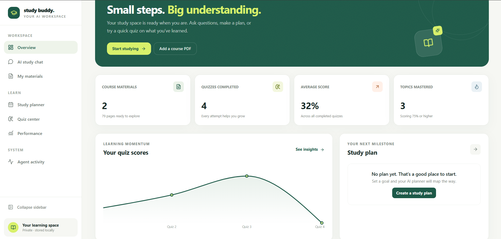
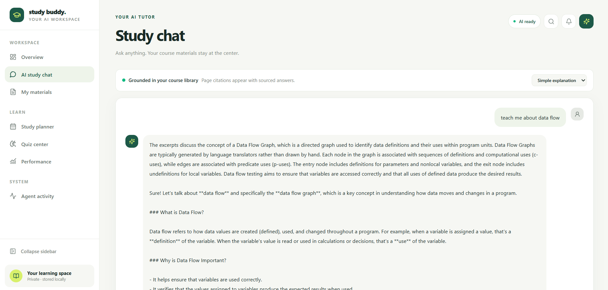
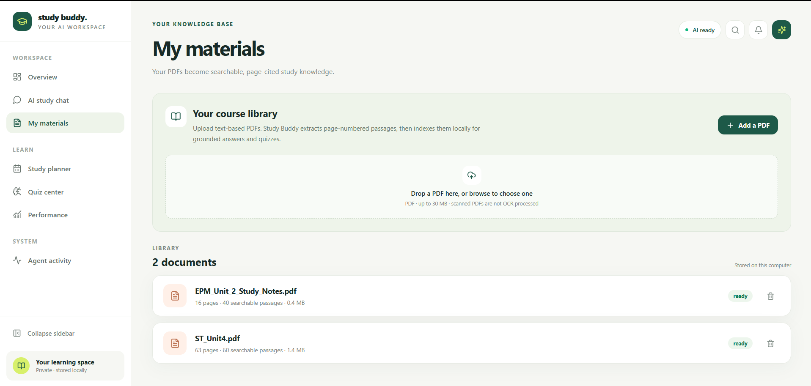
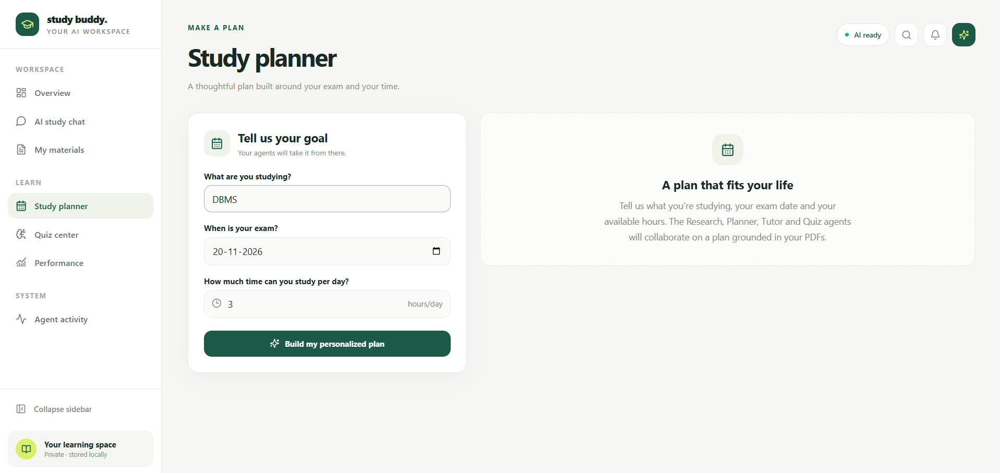
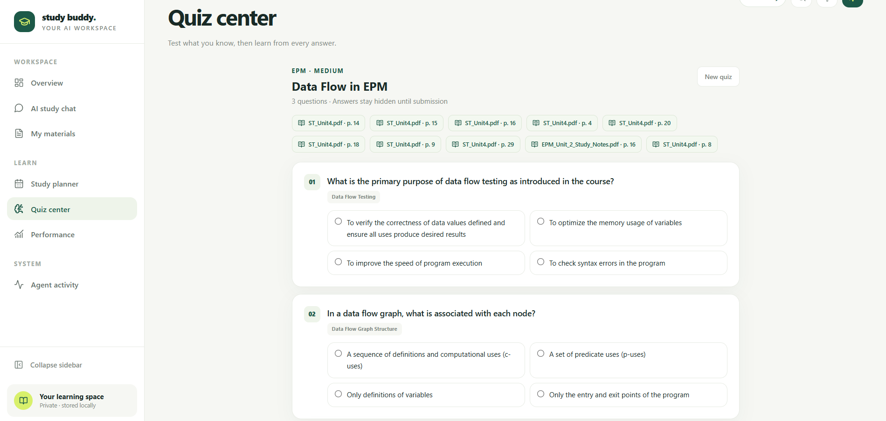
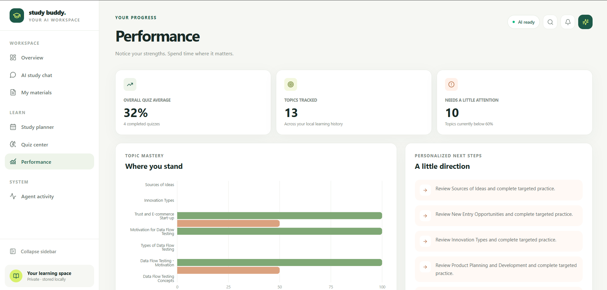
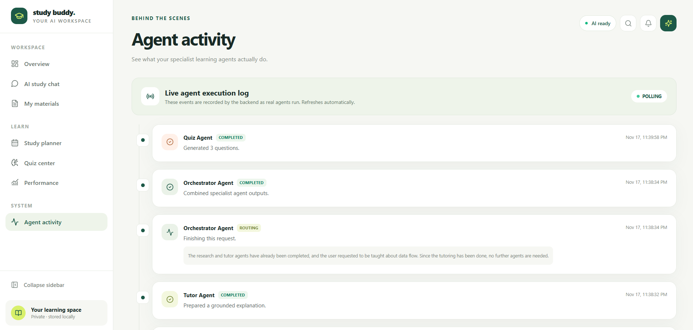

# Study Buddy AI

A locally run, PDF-grounded study workspace. Six specialized agents share LangGraph state to research course material, teach, create quizzes, plan study sessions, and analyze results. PDFs, FAISS indexes, plans, quizzes, preferences, agent activity, and learning history are stored under this project; there is no database service.

## Application Screenshots

### 1. Overview Dashboard


### 2. AI Study Chat


### 3. Document Library


### 4. Personalized Study Planner


### 5. Quiz Center


### 6. Performance Analytics


### 7. Agent Activity Monitor


---

## What is implemented

- **Orchestrator Agent** makes a structured routing decision for each chat turn and delegates one specialist at a time through conditional LangGraph edges. It uses shared workflow state, limits cycles, and combines completed agent outputs.
- **Research Agent** retrieves local FAISS passages and extracts topics from those passages, preserving document and page metadata.
- **Tutor Agent** offers simple, detailed, example-based, and exam-oriented explanations grounded in retrieved excerpts.
- **Quiz Agent** creates MCQs and short-answer questions from retrieved sources, withholds answers until submission, scores attempts, saves results, and requests adaptive tutoring and a bounded retry for low scores.
- **Study Planner Agent** creates personalized dated sessions from discovered course topics, exam date, available hours, and weak-topic history.
- **Performance Agent** tracks topic scores and historical quiz outcomes in local JSON.
- **LangGraph workflows** implement autonomous exam preparation, adaptive learning, revision kits, knowledge-gap analysis, and conditional chat delegation.
- **Local RAG** extracts text from PDFs with PyPDF, splits page-preserving overlapping chunks, embeds them with `sentence-transformers/all-MiniLM-L6-v2`, and indexes them with FAISS.
- **React dashboard** includes Overview, AI study chat, My materials, Study planner, Quiz center, Performance, and a backend-fed Agent activity log (polled every five seconds).
- Backend tests cover PDF extraction, chunking, FAISS retrieval, citations, orchestrator routing, quiz scoring, JSON persistence, and plan generation.

## Requirements

- Windows 10/11, Python 3.11+, and Node.js 18+.
- Access to your configured **GPT-4.1-mini OpenAI-compatible deployment**. This project does not choose an endpoint format or deployment name for you.
- The first document upload downloads the configured local sentence-transformer model if it is not already cached. Internet access may be required once for dependency/model downloads; study documents and embeddings are kept locally.

## Configure the model

The project-root `.env` already contains blank values. Open it and fill in the values supplied by your API administrator:

```env
OPENAI_API_KEY=your-provided-key
OPENAI_BASE_URL=your-provided-openai-compatible-endpoint
OPENAI_MODEL=your-provided-gpt-4.1-mini-deployment-name

EMBEDDING_MODEL=sentence-transformers/all-MiniLM-L6-v2
BACKEND_HOST=127.0.0.1
BACKEND_PORT=8000
FRONTEND_PORT=5173
```

`.env.example` contains conspicuous placeholders. Do not copy an endpoint convention from another provider; paste the exact compatible endpoint and deployment name you were given. The key is read only by the Python backend and is never placed in a frontend bundle or API response. `/api/health` reports whether the three model settings are present; it does not test the remote deployment.

## Run locally (PowerShell)

From the project root, in the first terminal:

```powershell
cd .\backend
python -m venv venv
.\venv\Scripts\Activate.ps1
python -m pip install -r requirements.txt
python run.py
```

The API listens on `http://127.0.0.1:8000`; interactive API documentation is at `http://127.0.0.1:8000/docs`. `python run.py` reads `BACKEND_HOST` and `BACKEND_PORT` from the root `.env`.

In a second terminal:

```powershell
cd .\frontend
npm install
npm run dev
```

Open [http://localhost:5173](http://localhost:5173). The frontend talks to `http://127.0.0.1:8000` by default; set `VITE_API_BASE_URL` in the frontend environment if you intentionally change the API address. Vite reads `FRONTEND_PORT` from the project-root `.env`.

If PowerShell blocks venv activation, run `Set-ExecutionPolicy -Scope Process Bypass` in that terminal and activate again.

## Run tests

With the backend virtual environment active:

```powershell
cd .\backend
python -m pytest -q
```

Build-check the frontend:

```powershell
cd .\frontend
npm run build
```

## Diagnose the Windows PDF/embedding pipeline

To verify model download/load, real embedding inference, PDF text extraction and chunking, isolated FAISS persistence/search, and a full FastAPI PDF upload/index/delete cycle using the configured local embedding model, run this from the project root:

```powershell
.\backend\venv\Scripts\python.exe .\backend\tests\test_embedding_pipeline.py
```

The script uses a temporary test PDF and removes the upload after success. Logs identify each operation. In the upload endpoint, failures include the stage, exception type/message, and server traceback; the embedding and FAISS layers log their own detailed tracebacks as well. Hugging Face caches at the resolved `HF_HUB_CACHE` path (normally `C:\Users\<you>\.cache\huggingface\hub`). On Windows without Developer Mode or administrator rights, Hugging Face may warn that it cannot create symlinks and use regular file copies instead; that warning is not itself a model-loading failure.

## End-to-end study flow

1. Configure the three `OPENAI_*` values and start both local servers.
2. Upload a text-based DBMS PDF under **My materials**. Wait until extraction and indexing succeed; scanned/image-only PDFs are rejected with an explicit OCR limitation.
3. Use **Study planner** to select DBMS, an exam date (for the requested three-day demo, select three days from today), and three hours/day. The exam-preparation LangGraph sequence runs Research → Planner → Tutor → Quiz and saves the plan and an unanswered diagnostic quiz.
4. Open the diagnostic in **Quiz center**, submit answers, and review score explanations. A score below 60% triggers Performance analysis, a Tutor explanation, and a fresh targeted quiz, with no more than two retries.
5. View weak/strong topics and saved progress under **Performance**. The live **Agent activity** screen polls the backend’s actual persisted execution events.

Chat also accepts an exam-preparation request. The orchestrator extracts the dates/hours when provided; if omitted while a plan is requested, it assumes seven days and two hours/day and records that assumption in its routing rationale.

## Local data and API

```text
data/
├── documents/     uploaded PDFs
├── faiss_index/   local FAISS index
└── memory/        JSON profile, history, results, plans, preferences, quizzes, events
```

Available routes include:

- `POST /api/documents/upload`, `GET /api/documents`, `DELETE /api/documents/{document_id}`
- `POST /api/chat`
- `POST /api/workflows/exam-preparation`, `/adaptive-learning`, `/revision-kit`, `/knowledge-gaps`
- `POST /api/quiz/generate`, `/api/quiz/submit`, `GET /api/quiz/history`
- `POST /api/study-plan/generate`, `GET /api/study-plan`
- `GET /api/performance`, `GET /api/agents/activity`, `GET /api/health`

## Current limitations

- No API credentials or deployment endpoint were supplied in the workspace. All LLM-backed flows return an explicit configuration error until the `.env` values are filled; this project does not fake successful model responses.
- Scanned PDFs have no OCR support. Password-protected PDFs without an empty password and PDFs with no extractable text are not indexed.
- Local embedding inference runs on CPU. The model may take time to download and load on the first PDF upload.
- Quiz short answers are checked by normalized exact text matching; MCQs are the best-supported evaluation mode. The deployment is required to generate content, explain, route, and plan.
- Agent Activity uses five-second polling rather than SSE. It shows persisted backend events, not simulated progress.
- Local JSON persistence is intended for a single-user local application, not concurrent multi-user hosting. No cloud services or database are used.
